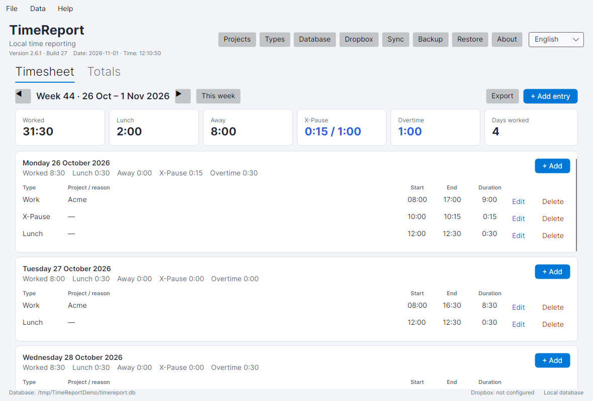
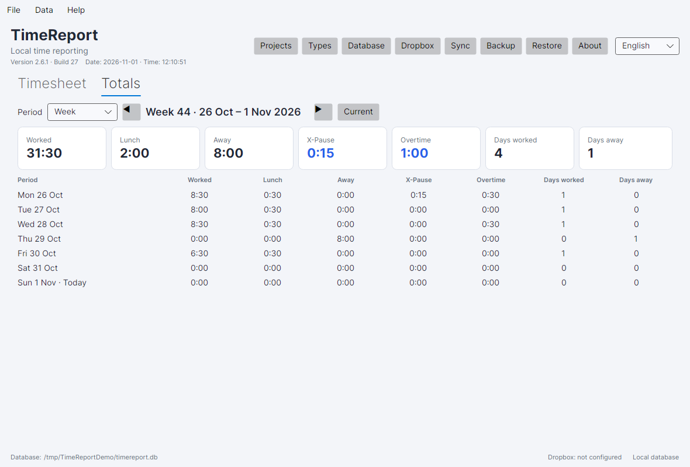

# TimeReport

A local-first desktop time report for Linux and Windows, written in C#/.NET 10 with
Avalonia. The published executables are self-contained single-file binaries: they do
not require Python or a separate .NET installation.

> **Just want to use it?** Download one executable and run it. No installer, account,
> or .NET installation is required. [Jump to the quick start](#the-easy-way-to-get-up-and-running)

## The easy way to get up and running

### 1. Download the app

Open the [latest release](https://github.com/RogerBergling/TimeReport/releases/latest)
and download the file for your system:

| System | File |
|---|---|
| Linux | `TimeReport-linux-x86_64` |
| Windows | `TimeReport-windows-x86_64.exe` |

The same binaries are also in the repository's [`release/`](release/) folder. You can
verify a download with `SHA256SUMS.txt` from the release page.

### 2. Start it

**Linux**

```bash
chmod +x TimeReport-linux-x86_64
./TimeReport-linux-x86_64
```

On a minimal Linux installation, install the X11/fontconfig libraries listed in
[`release/README.md`](release/README.md).

**Windows**

Double-click `TimeReport-windows-x86_64.exe`. The executable is unsigned, so Windows
SmartScreen may show a warning on first launch.

### 3. Add your first entry

1. Click **Projects** and add a project.
2. Click **+ Add entry** or press `Ctrl+N`.
3. Choose the date, type, project, start and end times, then click **Save**.
4. Open the **Totals** tab to see daily, weekly, monthly, yearly and all-time totals.

### 4. Keep your data safe

Your data is stored in an encrypted local database. Back up the database and the
`settings.json.key` file together. Without the key, the encrypted database cannot be
recovered.

| System | Default database |
|---|---|
| Linux | `~/.local/share/timereport/timereport.db` |
| Windows | `%LOCALAPPDATA%\TimeReport\timereport.db` |

Use **File → Backup database…** for backups. Do not share the database or the key file.

### 5. Optional next steps

- [Export to Excel](#excel-export) — **File → Export to Excel (.xlsx)…**
- [Dropbox sync](#optional-dropbox-sync) — **File → Dropbox sync…**
- [Settings](#settings) — **Data → Settings…**
- [Check for updates](#updates) — **Help → Check for updates…**
- [Build from source](#building-from-source) — for developers

The rest of this README is the full reference for data, backups, Dropbox, building,
packaging and operations.

## Screenshots



*Main window with a demo week, overtime, build number and live date/time.*



*Totals view with daily rows, X-Pause and overtime.*

## Features

- Weekly timesheet showing all seven days, Monday–Sunday.
- Multiple entries per day: work, lunch, away and X-Pause.
- Work entries have a project, start time and end time.
- Projects are stored in the database. Add, rename, archive and delete unused projects
  from the GUI.
- Entry types are managed like projects. Add custom types such as Meeting, Training or
  Sick, choose whether each behaves like Work, Lunch, Away or X-Pause, and rename,
  archive or delete unused types.
- Lunch is deducted from work time when it overlaps a work entry.
- Away entries have a free-text reason and a start/end time. They are tracked separately
  from work.
- X-Pause is tracked as a separate weekly benefit:
  - Monday–Friday only.
  - 15-minute steps: 15, 30, 45 or 60 minutes.
  - Maximum 1 hour per ISO week.
  - Must be strictly inside a work entry. It cannot start at the beginning or end at the
    end of the workday.
  - It does not reduce worked hours.
- Daily totals, weekly totals, monthly totals, yearly totals and an all-time total.
- Backup and restore from the GUI, with automatic safety backups, retention and
  backup verification.
- SQLCipher encryption at rest, with encrypted backups and automatic migration of
  existing plaintext databases.
- Optional Dropbox sync with encrypted OAuth refresh tokens, client-side AES-GCM
  encryption of uploaded databases, revision-checked uploads, proxy/custom-CA support
  and conflict detection.
- Configurable time zones, per-entry time zones and time-zone-aware "today" handling.
- Configurable daily and weekly overtime thresholds, shown in totals and Excel.
- In-client update checking against GitHub releases.
- Export any date range to an Excel `.xlsx` workbook with summary, entries, daily/monthly totals, projects and types.
- Switch the interface and calendar between English and Swedish.
- 24-hour clock and ISO dates (`YYYY-MM-DD`).
- Keyboard-friendly operation with shortcuts and default/cancel dialog buttons.
- Inline validation, undo for the last deleted entry and a single-instance guard.
- Light, dark, high-contrast and system theme variants under **Data → Theme**.
- Main window shows the application version, build number and a live date/time clock in the selected time zone.
- No account or telemetry. Optional Dropbox sync and update checks are the only network features.

## Keyboard shortcuts

| Shortcut | Action |
|---|---|
| `Ctrl+N` | Add an entry |
| `Ctrl+E` | Export to Excel |
| `Ctrl+B` | Back up the database |
| `Ctrl+P` | Manage projects |
| `Ctrl+T` | Manage entry types |
| `Ctrl+Shift+S` | Sync with Dropbox |
| `F5` | Refresh |
| `F1` | About |
| `Ctrl+Q` | Exit |
| `Ctrl+Left` / `Ctrl+Right` | Previous / next week |

Dialogs support `Enter` for the primary action and `Escape` for cancel.

## Data storage

The database is deliberately stored outside the application folder. Replacing or
upgrading the executable does not remove your data.

| Platform | Default location |
|---|---|
| Linux | `$XDG_DATA_HOME/timereport/timereport.db`, normally `~/.local/share/timereport/timereport.db` |
| Windows | `%LOCALAPPDATA%\TimeReport\timereport.db` |

Existing TimeReport databases are migrated automatically, including databases created
by the earlier Python version. A pre-migration backup is created first.

The database is encrypted at rest with SQLCipher. The encryption key is stored in a
separate owner-only settings key file; on Windows that key is additionally protected
with the current user's DPAPI key. Back up the database and `settings.json.key`
together. If the key is lost, the encrypted database cannot be recovered.

The app also writes a rotating log file, `timereport.log`, in the same data folder.
Backups made automatically before a restore, migration, encryption or repair are
placed in the `backups/` subfolder. The newest `BackupRetentionCount` automatic
backups are kept.

### Changing the database location

Use **File → Database location…** to choose a different database file or folder. The
choice is saved in a small settings file:

| Platform | Settings file |
|---|---|
| Linux | `$XDG_CONFIG_HOME/TimeReport/settings.json`, normally `~/.config/TimeReport/settings.json` |
| Windows | `%APPDATA%\TimeReport\settings.json` |

If the selected file already exists, TimeReport validates and opens it. If it does not
exist, TimeReport can copy the current database to the new location before switching;
otherwise it creates a new empty database there. The old database file is left
untouched, so it remains available as a manual backup.

You can also override the location for testing or portable use:

```bash
TimeReport --database /path/to/custom.db
TimeReport --data-dir /path/to/data
TimeReport --version
TimeReport --help
```

```powershell
TimeReport.exe --database C:\path\to\custom.db
TimeReport.exe --data-dir C:\path\to\data
```

The `--database` option points at a database file. `--data-dir` points at a folder and
uses `timereport.db` inside it.

## Backup and restore

Use **File → Backup database…** to write a consistent SQLite backup to any location.

Use **File → Restore database…** to replace the current database. Restore:

1. Validates the selected file with SQLite's integrity check.
2. Checks that it has the expected TimeReport schema.
3. Creates an automatic backup of the current database in `backups/`.
4. Replaces the database atomically.
5. Refuses databases from a newer, unsupported schema version.

Backups are SQLCipher-encrypted databases when encryption is enabled. Restoring them
requires the matching database encryption key, so keep the database and
`settings.json.key` together. They contain personal time data, so store them securely.

Use **File → Verify backup…** to validate a backup, and **File → Check database
integrity…**, **Compact database…** or **Repair database…** for maintenance. Repair
creates a pre-repair backup first.

## Optional Dropbox sync

TimeReport can keep a local database and sync it to Dropbox. Local changes are uploaded
automatically when auto-sync is enabled. On startup, a newer Dropbox copy is downloaded
if the local database has not changed since the last sync. If both sides changed,
TimeReport reports a conflict instead of overwriting either copy; use **Sync now** to
choose which database to keep.

To configure it:

1. Create a Dropbox app in the [Dropbox App Console](https://www.dropbox.com/developers/apps).
2. Enable the scopes `files.content.read`, `files.content.write` and
   `files.metadata.read`.
3. Add this redirect URI to the app:
   `http://127.0.0.1:53682/dropbox-callback`
4. In TimeReport, open **File → Dropbox sync…**, enter the app key and optional app
   secret, then click **Connect to Dropbox** and authorize in the browser.
5. Keep or change the remote path (default `/TimeReport/timereport.db`), optionally
   enter a **Sync encryption passphrase**, enable **Sync automatically after changes**,
   and use **Sync now** for the first sync. Use the same passphrase on every device
   that shares the Dropbox file.
6. If your network requires it, configure an HTTPS proxy and a custom CA certificate
   in the same dialog.

The app uses Dropbox OAuth with a long-lived refresh token, so it can keep syncing
without asking you to paste a new short-lived access token every few hours. Tokens are
encrypted with AES-GCM before they are written to the settings file. The encryption key
is stored in a separate owner-only file; on Windows that key is additionally protected
with the current user's DPAPI key. The settings file and key are still sensitive, so
protect the account and the data folder. If you back up the settings file, keep
`settings.json.key` with it; without the key the stored tokens and database key cannot
be decrypted. Dropbox uploads are encrypted with AES-GCM before they leave the machine by default; the encryption checkbox can be disabled if your policy requires otherwise.
Conflicts show local and remote modification times and let you keep either side.
Dropbox sync is optional and the app works fully offline.

## Building from source

Requirements:

- .NET 10 SDK.
- Linux GUI builds need the usual X11/fontconfig desktop libraries. Windows needs the
  standard Windows desktop runtime libraries included with Windows 10+.

```bash
dotnet restore TimeReport.slnx
dotnet build TimeReport.slnx -c Release
dotnet run --project src/TimeReport/TimeReport.csproj -c Release
```

Local builds show `Build local`. CI passes the GitHub run number and commit SHA as
MSBuild metadata, so released binaries show the actual build number.

## Publishing self-contained executables

The project is configured for self-contained single-file publishing. No .NET runtime is
required on the target machine.

### Linux

```bash
dotnet publish src/TimeReport/TimeReport.csproj \
  -c Release \
  -r linux-x64 \
  --self-contained true \
  -p:PublishSingleFile=true \
  -p:IncludeNativeLibrariesForSelfExtract=true \
  -p:EnableCompressionInSingleFile=true \
  -o dist/linux

# Result: dist/linux/TimeReport
```

### Windows

```powershell
dotnet publish src/TimeReport/TimeReport.csproj `
  -c Release `
  -r win-x64 `
  --self-contained true `
  -p:PublishSingleFile=true `
  -p:IncludeNativeLibrariesForSelfExtract=true `
  -p:EnableCompressionInSingleFile=true `
  -o dist/windows

# Result: dist\windows\TimeReport.exe
```

The GitHub Actions workflow in `.github/workflows/build.yml` runs tests on Linux and
Windows, builds both executables, and uploads them as build artifacts.

## Packaging

After publishing, create distributable archives with:

```bash
./scripts/package-linux.sh 2.6.1
```

```powershell
./scripts/package-windows.ps1 2.6.1
```

The Linux script creates a `.tar.gz` and, when `dpkg-deb` is available, a `.deb`
with a desktop entry and icon. The Windows script creates a `.zip`. Both include
the README, MIT license and third-party notices. See [`packaging/README.md`](packaging/README.md).

## Testing

```bash
dotnet test TimeReport.slnx -c Release
```

The Linux GUI smoke test requires Xvfb:

```bash
xvfb-run -a dotnet run --project src/TimeReport/TimeReport.csproj -c Release -- \
  --smoke-test --data-dir /tmp/timereport-test
```

## Project layout

```text
src/TimeReport/
  App.axaml                 Application theme and startup
  Program.cs                CLI and Avalonia bootstrap
  Data/Database.cs          SQLite schema, migrations, backup and restore
  Models/                   Projects, entries, totals
  Services/                 Validation, totals, paths, time utilities, logging
  Services/ExcelExportService.cs  Excel workbook generation
  Services/XlsxWriter.cs    Dependency-free XLSX writer
  ViewModels/               Main timesheet and totals view models
  Views/                    Main window and dialogs
  Styles/AppStyles.axaml    Shared light/dark theme resources
  Assets/                   Application icon
packaging/                  Linux desktop entry and packaging notes
scripts/                    Linux/Windows packaging scripts
tests/TimeReport.Tests/     xUnit tests for time, database, validation, totals,
                            backup, Dropbox sync, token protection and Excel export
```

## Settings

Use **Data → Settings…** to configure:

- time zone and theme;
- daily and weekly overtime thresholds;
- automatic backup retention;
- whether to check for updates on startup.

The same dialog is available without editing `settings.json` by hand.

## Time zones and overtime

The selected time zone controls "today", new-entry defaults and the default date
ranges. Each entry stores the time zone that was selected when it was created, so
historical entries remain meaningful when you travel or change the application time
zone.

Overtime is calculated from worked time after lunch deductions. Set a daily threshold,
a weekly threshold, or both. Weekly overtime is added only above the daily overtime
already counted, so the two thresholds do not double-count the same hours.

## Updates

Use **Help → Check for updates…** to query the latest GitHub release. Startup checking
can be disabled in Settings, and update checks respect the configured proxy and custom
CA certificate. The app opens the release page; it does not silently replace the
executable.

## Excel export

Use **File → Export to Excel (.xlsx)…** or the **Export** button on the timesheet.
Choose a custom start/end date, or use the quick presets for this/last month,
this/last year, or all time. A custom range can span any number of months.

The workbook contains:

- **Summary** — period, generated time, totals and database path.
- **Entries** — every entry with date, weekday, type, category, project, away reason,
  start, end and duration.
- **Daily totals** — worked, lunch, away and X-Pause for every day in the range.
- **Monthly totals** — totals for every month touched by the range.
- **Projects** — project status, entry count and work hours.
- **Types** — type category/status, entry count and total hours.

Work hours in the Summary, Daily, Projects and Types sheets deduct overlapping
lunch, so the sheets reconcile with each other.

The export uses the modern Excel `.xlsx` format, which Excel, LibreOffice and other
spreadsheet applications can open.

## Entry types

TimeReport ships with the types **Work**, **Lunch**, **Away** and **X-Pause**. Open
**Data → Entry types…** or the **Types** button to manage them.

Each custom type has a behavior category:

- **Work** — requires a project, counts as worked time.
- **Lunch** — deducted from overlapping work time.
- **Away** — tracked as away time; the type name is used as the away reason when no
  extra reason is entered.
- **X-Pause** — follows the weekly X-Pause rules and is tracked separately.

Types used by existing entries cannot be deleted; archive them instead. Archived types
remain visible on historical entries but are not offered for new entries.

## Troubleshooting

TimeReport writes a rolling `timereport.log` in the data folder. The **About**
dialog shows the exact path and has an **Open log file** button. The log contains
startup information and errors; it does not contain time entries.

If the application cannot open its database, keep the database file and the log.
Start TimeReport against a known-good backup or an empty database with
`--database /path/to/file.db`, then use **Restore database…** to recover the data.
A pre-restore backup is created automatically before a restore.

## Rules and assumptions

- Week starts Monday and includes Saturday/Sunday.
- Work entries cannot overlap other work or away entries.
- Lunch may overlap work and is deducted from worked time. Lunch cannot overlap another
  lunch, away time or X-Pause.
- Away entries cannot overlap work, lunch, X-Pause or another away entry.
- X-Pause is not deducted from worked time; it is displayed separately.
- A work entry must end on the same date. Cross-midnight shifts are not supported in
  version 2.
- The database is single-user and encrypted at rest. It is intended for local use.
- Dates are ISO dates and times use the 24-hour clock.

## License

TimeReport is released under the [MIT License](LICENSE). It is free to use, modify
and distribute. The software is provided “as is”, without warranty; use it at your
own risk. See [TERMS.md](TERMS.md) for the disclaimer and responsibilities.

## Contributing and security

See [CONTRIBUTING.md](CONTRIBUTING.md) for build, test and release steps,
[CHANGELOG.md](CHANGELOG.md) for release history, [SECURITY.md](SECURITY.md) for
the security policy, [THIRD-PARTY-NOTICES.md](THIRD-PARTY-NOTICES.md) for
dependency licenses and [docs/ARCHITECTURE.md](docs/ARCHITECTURE.md) for the
architecture overview.

## Version

`2.6.1`
